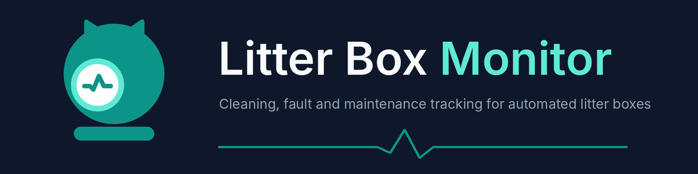
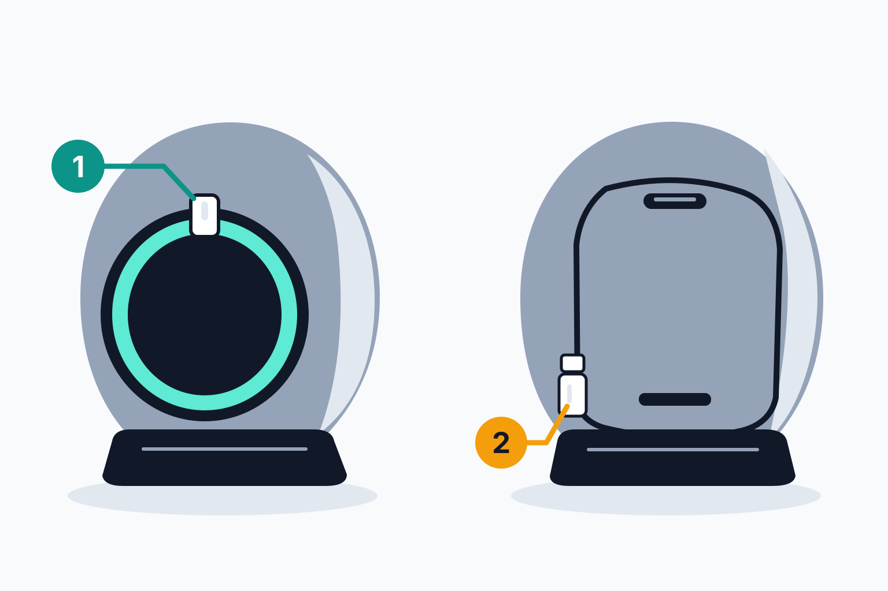

# Litter Box Monitor



A Home Assistant custom integration that turns two ordinary door/contact sensors on an automated cat litter box into a **virtual appliance**. You get an operational status, fault detection, cleaning statistics and maintenance tracking.

It runs entirely inside Home Assistant Core. It needs no Node-RED, MQTT, cloud service, external database or extra Python packages.

[](https://github.com/libertybell95/ha-litter-box-monitor/actions/workflows/validate.yml)
[](https://github.com/libertybell95/ha-litter-box-monitor/actions/workflows/tests.yml)

---

## 1. Features

- **Operational state machine**: `Ready` / `Cleaning` / `Error` / `Unavailable`.
- **Stuck-door detection**: the timeout fires even if no further sensor event arrives. It survives restarts and is not restarted from zero after a reboot.
- **Cleaning statistics**: last cleaning, last and average duration, cleans today, yesterday, in the last 7 days, and in total. Daily counters reset at local midnight with no door event required, and DST is handled.
- **Bounded cycle history**: 90 days by default, configurable from 30 to 365. It is stored in Home Assistant's own `.storage` and works with Recorder disabled or purged.
- **Maintenance tracking**: "Last Bag Door Opened" and "Days Since Bag Door Opened" are counted in calendar days, with an optional "Maintenance Due" reminder.
- **Native events for automations**: event entities and namespaced bus events for *cleaning completed*, *fault detected*, *fault cleared* and *bag door opened*. Each fault produces exactly one event.
- **Restart recovery**: persisted cycle start, fault and statistics are reconciled with the live sensors at startup, including sensors that load late.
- **Repairs**: issues are raised for missing or long-unavailable input sensors. Inputs that are renamed are followed automatically.
- **Diagnostics download** for troubleshooting.
- **Multiple litter boxes**: each config entry is its own device.

## 2. Hardware assumptions

| Input | Required | `on` | `off` |
| --- | --- | --- | --- |
| **Main door** binary sensor | yes | door **open**: idle | door **closed**: cleaning |
| **Rear / bag door** binary sensor | for maintenance tracking | bag door open | bag door closed |

- The main door closes while the box cleans and reopens when cleaning finishes. If it stays closed longer than the cleaning timeout (default 5 minutes), something is probably jammed.
- Any integration can supply the sensors: Zigbee, Z-Wave, ESPHome, Shelly, template sensors and so on. Both must be `binary_sensor` entities. If your sensor reports the opposite polarity, wrap it in a [template binary sensor](https://www.home-assistant.io/integrations/template/) that inverts it.
- Opening the bag door does **not** prove the bag was replaced. That is why the sensor is named *Last Bag Door Opened*.

### Tested hardware



**1** Front/main door sensor · **2** Bag door sensor

The integration was developed using an **ELS Pet Spaceship II**, a globe-style self-cleaning box, fitted with two Zigbee contact sensors. It runs completely independently of the litter box: it never talks to the box, its app or any cloud service, and it only reads the two contact sensors through Home Assistant.

- **Front/main door:** the door the cat goes in and out through. It closes during the cleaning cycle and reopens when the cycle finishes. The sensor is mounted on the top rim of the round front entrance.
- **Bag door:** the rear door over the waste storage bay, where the cleaning cycle deposits waste. A two-piece sensor at the door's lower-left edge reports when the bag door is opened.

Any other automated litter box works the same way, provided one contact sensor sees the front/main door closed for the whole cleaning cycle and another sees the bag door opening. This project is not affiliated with or endorsed by ELS Pet.

## 3. Installation via HACS

1. In HACS, open the ⋮ menu, choose **Custom repositories**, add `https://github.com/libertybell95/ha-litter-box-monitor` and set the type to **Integration**.
2. Search for **Litter Box Monitor**, click **Download** and pick the latest release.
3. Restart Home Assistant.
4. Continue with [Configuration](#5-configuration).

Requires Home Assistant **2026.10** or newer.

## 4. Manual installation

1. Download the latest release, either `litter_box_monitor.zip` or the source archive.
2. Copy `custom_components/litter_box_monitor/` into your Home Assistant config directory so that you have `/config/custom_components/litter_box_monitor/manifest.json`.
3. Restart Home Assistant.

## 5. Configuration

Go to **Settings → Devices & services → Add integration → Litter Box Monitor**.

**Step 1: litter box**

| Field | Default | Notes |
| --- | --- | --- |
| Device name | `Litter Box` | Becomes the device name and the entity ID prefix. |
| Main door sensor | `binary_sensor.cat_litter_box_main_door` if it exists | Must be a binary sensor. |
| Rear / bag door sensor | `binary_sensor.cat_litter_box_bag_door` if it exists | Required when maintenance tracking is on, and must differ from the main door. |
| Cleaning timeout | 5 min | Range 1–120 min. |
| Fault monitoring | on | Raises the stuck-door fault. |
| Maintenance tracking | on | Tracks the bag door. |
| Cleaning cycle statistics | on | Counts, durations and history. |
| Fault events | on | Fires fault detected/cleared events. |

**Step 2: maintenance** (only shown when maintenance tracking is on)

| Field | Default | Notes |
| --- | --- | --- |
| Maintenance reminder after | 0 (disabled) | Creates *Maintenance Due* when greater than 0. |
| Initial Last Bag Door Opened | empty | ISO 8601, Unix seconds or Unix **milliseconds** (Node-RED format). |
| Initialize to now | off | Legacy Node-RED behaviour. The value is labelled `initialized`, not `observed`. |

By default *Last Bag Door Opened* stays **unknown** until the bag door is actually seen opening.

**Changing settings later**

- **Configure** (options): timeout, toggles, reminder threshold and history retention. History is kept.
- **Reconfigure**: change the name or the input sensors. History is kept.
- **Action `litter_box_monitor.set_bag_door_opened`**: set the maintenance timestamp manually at any time. It takes `config_entry_id` and an optional `timestamp` (ISO 8601, Unix seconds or Unix milliseconds) and defaults to now.

## 6. Entities

Examples assume the device is named "Litter Box".

| Entity | Type | Notes |
| --- | --- | --- |
| `sensor.litter_box_status` | enum | `ready`, `cleaning`, `error`, `sensor_unavailable` (shown as Ready / Cleaning / Error / Unavailable). Attributes: `cleaning_started_at`, `cycle_start_source`, `cycle_verified`. |
| `sensor.litter_box_error_reason` | enum | `none` or `main_door_stuck_closed` (shown as None / Main door stuck closed). Attributes describe the active fault. |
| `sensor.litter_box_last_cleaning` | timestamp | Completion time of the last *counted* cycle. |
| `sensor.litter_box_last_cleaning_duration` | duration (s), measurement | |
| `sensor.litter_box_cleans_today` | total increasing | Resets at local midnight. |
| `sensor.litter_box_cleans_yesterday` | count | |
| `sensor.litter_box_cleans_last_7_days` | count | Today plus the previous 6 local dates. |
| `sensor.litter_box_total_cleans` | total increasing | Not affected by history pruning. |
| `sensor.litter_box_average_cleaning_duration` | duration (s), measurement | Mean over the last 30 local dates. |
| `sensor.litter_box_current_cleaning_duration` | duration (s) | **Disabled by default**. Refreshes every 10 s while cleaning. |
| `sensor.litter_box_last_bag_door_opened` | timestamp | Attribute `source`: `observed`, `manual` or `initialized`. |
| `sensor.litter_box_days_since_bag_door_opened` | days | Local calendar days, refreshed at midnight. |
| `binary_sensor.litter_box_problem` | problem | On while a mechanical fault is active. |
| `binary_sensor.litter_box_cleaning_active` | running | Unavailable while the main door sensor is unavailable. |
| `binary_sensor.litter_box_maintenance_due` | | Only when a reminder threshold is set. |
| `binary_sensor.litter_box_input_sensors` | connectivity (diagnostic) | Off while any input is unknown or unavailable. |
| `event.litter_box_cleaning` | event | `cleaning_completed` |
| `event.litter_box_fault` | event | `fault_detected`, `fault_cleared` (only when fault monitoring and fault events are on). |
| `event.litter_box_bag_door` | event | `bag_door_opened` |

Statistics entities only exist while statistics are enabled. Maintenance entities only exist while maintenance tracking is enabled.

### Bus events

Every event carries `config_entry_id`, `device_id` and `name`.

| Event type | Extra data |
| --- | --- |
| `litter_box_monitor_cleaning_completed` | `started_at`, `completed_at`, `duration_seconds`, `date`, `cleans_today`, `observation_gap_seconds` |
| `litter_box_monitor_fault_detected` | `fault_type`, `reason`, `detected_at`, `cleaning_started_at`, `elapsed_seconds` |
| `litter_box_monitor_fault_cleared` | the fault fields plus `cleared_at`, `resolution` (`main_door_opened` / `monitoring_disabled`), `active_seconds` |
| `litter_box_monitor_bag_door_opened` | `opened_at`, `previous_opened_at` |

Example `fault_detected` payload:

```json
{
  "config_entry_id": "01J…",
  "device_id": "4f1c…",
  "name": "Litter Box",
  "fault_type": "main_door_stuck_closed",
  "reason": "Main door stuck closed",
  "detected_at": "2026-10-13T15:05:00+00:00",
  "cleaning_started_at": "2026-10-13T15:00:00+00:00",
  "elapsed_seconds": 300
}
```

## 7. Operational state machine

```text
                door closes                      timeout elapsed
   ┌───────┐  ───────────────▶  ┌──────────┐  ─────────────────▶  ┌───────┐
   │ Ready │                    │ Cleaning │                      │ Error │
   └───────┘  ◀───────────────  └──────────┘                      └───────┘
       ▲        door opens                                            │
       │        (cycle counted)                                       │
       └───────────────────────── door opens (fault cleared) ─────────┘

   Main door unknown/unavailable → Unavailable (unless a fault is active,
   which keeps Error). The cycle and fault are preserved, not resolved.
```

**Counting rule.** A cycle is counted only if both of these hold:

1. The main door was observed going from open to closed and back to open. Observation gaps of 60 seconds or less are tolerated.
2. It reopened within the cleaning timeout, when fault monitoring is on.

Anything else is kept in history as `overtime` or `unverified` but never counted. This means a sensor outage or a restart can never invent a cleaning.

**Availability policy**

| Situation | Behaviour |
| --- | --- |
| Sensor `unknown`/`unavailable` | Not treated as opening or closing. Status becomes Unavailable. The cycle start is kept. The timeout pauses because it cannot be confirmed. An active fault is **kept**. |
| Back within 60 s, still closed | The cycle continues with its original start, so the timeout deadline does not move. |
| Back within 60 s, now open | The cycle is counted. Completion is attributed to the reconnection, with at most 60 s of error, and `observation_gap_seconds` is recorded. |
| Back after more than 60 s, now open | Outcome unknown: the cycle is discarded and not counted. An active fault clears because the door is open. |
| Back after more than 60 s, still closed | The original start is kept, so a fault is raised promptly if the timeout has passed. The cycle is marked unverified and will not be counted. |
| Sensor unavailable for more than 30 min | A repair issue is raised. It clears itself when the sensor returns. |
| Sensor entity deleted | A "sensor is missing" repair issue suggests **Reconfigure**. |
| Sensor entity renamed | The entry follows the new entity ID automatically. |

**Restart recovery.** On startup the integration:

1. Restores persisted data.
2. Reads current sensor states. A sensor that is not ready yet is reconciled when it first reports.
3. Reconciles them using the same rules, measuring the gap from the moment of shutdown.
4. Re-arms the timeout relative to the **stored cycle start**, not to the sensor's `last_changed`, which Home Assistant resets on restart.
5. Restores entities.

A fault that was already active is restored silently, so you get no duplicate notification. If the door is closed and nothing was stored, the sensor's `last_changed` is used only as a lower bound for the timeout, and that cycle is never counted.

**Persistence.** Data lives in `/config/.storage/litter_box_monitor.<entry_id>`. Critical transitions are saved immediately: cycle start and end, faults and maintenance. Everything else is batched and flushed on shutdown. Daily counts and cycle history are kept for the retention period (90 days by default) and pruned at midnight.

## 8. Notification automation examples

Notification routing is left to ordinary automations. Replace `notify.mobile_app_your_phone` with your own notify actions.

**Push a persistent alert when the door is stuck, and clear it when resolved**

```yaml
automation:
  - alias: Litter box – fault alert
    triggers:
      - trigger: event
        event_type: litter_box_monitor_fault_detected
    actions:
      - action: notify.mobile_app_your_phone
        data:
          title: "⚠️ {{ trigger.event.data.name }} error"
          message: >-
            {{ trigger.event.data.reason }} – closed for
            {{ (trigger.event.data.elapsed_seconds / 60) | round(0) }} minutes.
            Check the litter box.
          data:
            tag: litter_box_fault_{{ trigger.event.data.config_entry_id }}
            persistent: true

  - alias: Litter box – fault cleared
    triggers:
      - trigger: event
        event_type: litter_box_monitor_fault_cleared
    actions:
      - action: notify.mobile_app_your_phone
        data:
          message: clear_notification
          data:
            tag: litter_box_fault_{{ trigger.event.data.config_entry_id }}
```

Several phones can be listed as extra actions or in a `notify` group. Each fault triggers this automation **once**: re-evaluation, restarts and duplicate sensor events do not re-fire it.

**Bag reminder using the Maintenance Due sensor**

```yaml
automation:
  - alias: Litter box – empty the bag
    triggers:
      - trigger: state
        entity_id: binary_sensor.litter_box_maintenance_due
        to: "on"
    actions:
      - action: notify.mobile_app_your_phone
        data:
          message: >-
            The litter box bag door has not been opened for
            {{ states('sensor.litter_box_days_since_bag_door_opened') }} days.
```

**Using the event entity instead of the bus event** (works in the UI automation editor):

```yaml
triggers:
  - trigger: state
    entity_id: event.litter_box_fault
    not_from: unavailable
conditions:
  - condition: state
    entity_id: event.litter_box_fault
    attribute: event_type
    state: fault_detected
```

## 9. Migrating from Node-RED

The integration replaces the "Cat Litter Box Controller" Node-RED flow. It cannot read Node-RED's context files, so the bag door timestamp is copied across explicitly.

**Entity ID conflicts.** The Node-RED flow's device is also called "Litter Box", so its entities probably already use IDs like `sensor.litter_box_status`. If you name the new device "Litter Box", Home Assistant gives the new entities `_2` suffixes. Nothing is overwritten or deleted: the integration never touches the Node-RED entities. Recommended approach:

- During parallel testing, name the new device something distinct, such as **Litter Box Monitor**. Its entities then become `sensor.litter_box_monitor_status` and so on.
- After cutover, rename it (see the checklist below).

**State value differences**

| Node-RED | Integration |
| --- | --- |
| Status `Ready`/`Cleaning`/`Error` | `ready`/`cleaning`/`error`/`sensor_unavailable` (the UI shows the capitalised labels) |
| Error Reason `None` / free text | `none` / `main_door_stuck_closed` |
| Problem `on`/`off` | unchanged |
| Timestamps / durations / counts | unchanged semantics; counts exclude faulted cycles |

Update any automations or dashboards that compare raw state strings.

### Step 1: carry over the bag door timestamp

Use either source:

- **The Node-RED entity.** Open *Developer tools → States* and copy the state of the Node-RED *Last Bag Door Opened* sensor. It is an ISO timestamp.
- **The Node-RED context.** In Node-RED, open the *Context Data* sidebar, select the flow, refresh **Flow** context and copy `lastBagDoorOpened` (Unix milliseconds) from the `file` store.

Paste the value into **Initial Last Bag Door Opened** while adding the integration, or later run the action:

```yaml
action: litter_box_monitor.set_bag_door_opened
data:
  config_entry_id: <your entry id>   # pick the litter box in the UI editor
  timestamp: 1760348400000           # or "2026-10-13T08:00:00-05:00"
```

The value is labelled `manual`. Do **not** tick *Initialize to now* if you have a real value.

Node-RED's `cleansToday` lived only in runtime memory, so there is no cleaning history to import. Statistics start fresh.

### Step 2: parallel testing (both running, no duplicate notifications)

1. Add the integration with the device name **Litter Box Monitor** and the same two sensors.
2. Keep the Node-RED flow and its notification nodes **as they are**. They remain the only source of push notifications.
3. Do **not** create the notification automations from section 8 yet. To watch the new events without notifying your phones, use a test automation that only writes to the logbook or calls `persistent_notification.create`, or watch *Developer tools → Events* and subscribe to `litter_box_monitor_fault_detected`.
4. Compare the two sets of entities for a few days. Things worth exercising are a normal cycle, a Home Assistant restart in the middle of a cycle, and the bag door.

### Step 3: cutover checklist

- [ ] The new Status, Problem, Last Cleaning and Cleans Today matched Node-RED during testing.
- [ ] *Last Bag Door Opened* shows the migrated value with source `manual`, or a newer `observed` value.
- [ ] In Node-RED, **disable** the "Cat Litter Box Controller" flow tab and deploy. This stops its notifications.
- [ ] Create the notification automations from section 8 and test them by holding the main door closed past the timeout.
- [ ] Remove the Node-RED entities. In Node-RED, delete the flow's `ha-entity-config` nodes and deploy, then delete the leftover Node-RED "Litter Box" device or entities in Home Assistant if they remain.
- [ ] Optionally rename the new device to "Litter Box" via *Settings → Devices → Litter Box Monitor → ✏️* and accept **update entity IDs**. The IDs become `sensor.litter_box_status` and so on.
- [ ] Update dashboards and automations that used the old IDs or capitalised state values.
- [ ] Delete the disabled Node-RED flow once you are satisfied.

## 10. Updating

- **HACS**: an update entity appears when a new release is published. Install it and restart Home Assistant.
- **Manual**: replace `custom_components/litter_box_monitor/` and restart.

Stored history is versioned and kept across updates.

**Release process (maintainers)**

1. Bump `version` in `custom_components/litter_box_monitor/manifest.json` and `pyproject.toml`.
2. Commit, then tag `vX.Y.Z` (for example `v0.1.0`) and publish a GitHub release from that tag.
3. The `Release` workflow checks that the tag matches the manifest version and attaches `litter_box_monitor.zip`. HACS uses the GitHub release list.

## 11. Troubleshooting

- **Status is `Unavailable`**: the main door sensor is unknown or unavailable. Check `binary_sensor.litter_box_input_sensors` and its attributes, then the sensor's own integration and battery.
- **A cleaning wasn't counted**: download the diagnostics (*device page → ⋮ → Download diagnostics*). The `recent_transitions` list shows `cycle_discarded`, `cycle_unverified` or `outcome: overtime` with the reason. Statistics are deliberately conservative after outages and restarts.
- **False stuck-door faults**: your box may take longer than the timeout. Raise *Cleaning timeout* under **Configure**.
- **Repair issue "sensor is missing"**: use **Reconfigure** to select the replacement sensor. History is kept.
- **Debug logging**:

  ```yaml
  logger:
    logs:
      custom_components.litter_box_monitor: debug
  ```

  Debug logs cover startup restoration, reconciliation decisions, timer scheduling and emitted events. Ordinary sensor updates are not logged.

## 12. Development and testing

```bash
uv venv --python 3.14 && uv sync --group dev
uv run ruff check . && uv run ruff format --check .
uv run pytest -q
```

- `state_machine.py`: pure-Python state machine with no Home Assistant imports, unit-tested in `tests/test_state_machine.py`.
- `coordinator.py`: Home Assistant glue (subscriptions, timers, storage, events, repairs).
- `tests/test_init.py`, `tests/test_calendar_maintenance.py` and `tests/test_config_flow.py` run inside a real Home Assistant test instance via `pytest-homeassistant-custom-component`, with frozen time.

CI runs hassfest, HACS validation, ruff and pytest (`.github/workflows/`). To run hassfest locally:

```bash
docker run --rm -v "$PWD:/github/workspace:ro" ghcr.io/home-assistant/hassfest
```

## 13. Limitations

- **Conservative statistics.** Cycles that overlap a sensor outage or Home Assistant downtime of more than 60 s are not counted, and neither are cycles that exceed the timeout.
- **Bag door is not bag replacement.** It only records that the rear door was opened.
- **No direct Node-RED import.** Values must be copied as described above, and Node-RED never stored cleaning history.
- **Outage behaviour.** While the main door sensor is unavailable, the stuck-door timeout cannot fire. It is re-evaluated against the original start time when the sensor returns.
- **Long downtime.** If Home Assistant is down for longer than the timeout while the door is closed both before and after, a fault is reported because the door was observed closed beyond the timeout. Whether it reopened in between cannot be known.
- **Retention.** History retention is 30–365 days. *Total Cleans* is not pruned.

## License

MIT. See [LICENSE](LICENSE).
